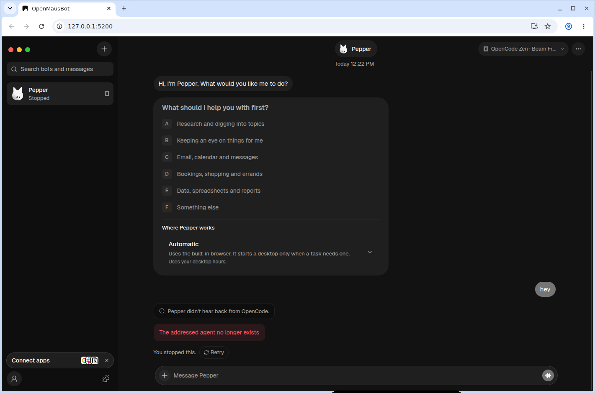
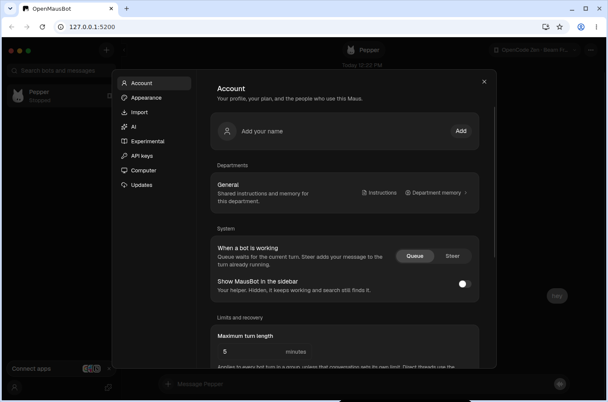

# Screenshots

Taken from OpenMausBot running locally on Linux, in dark mode, after the settings and UI clean-up.

## Chat

A bot's conversation, with the composer, the model picker and the sidebar.

## Settings

Settings is a single panel with one page per area: Account, Appearance, Import, AI, Experimental, API keys, Computer, Browser and Updates.

