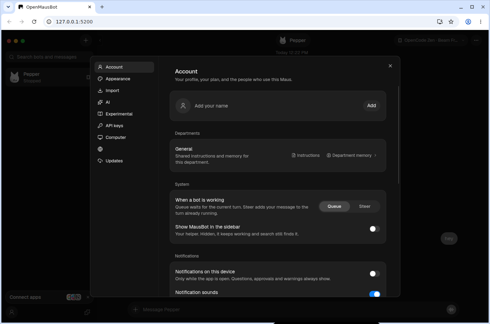
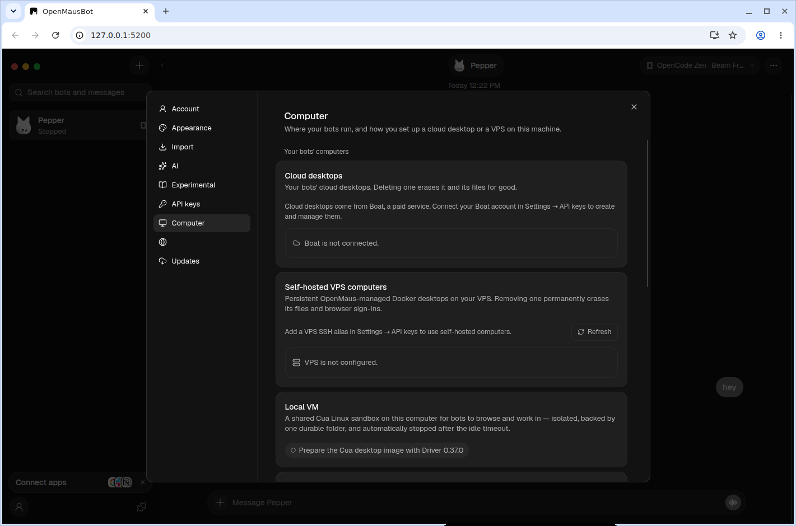
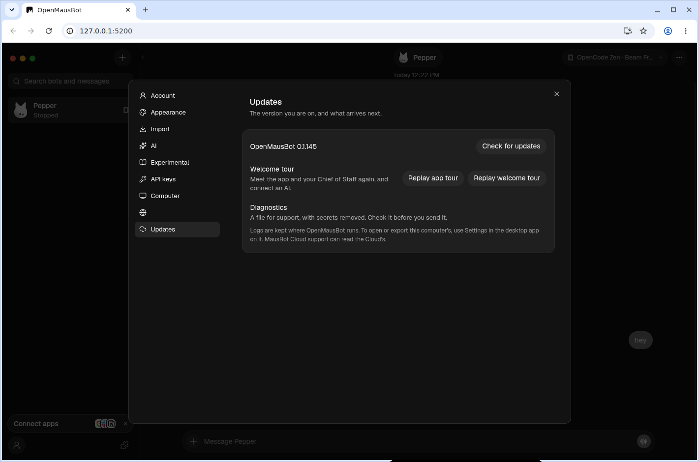

# Screenshots

Taken from OpenMausBot running on Linux, in dark mode, against the current `main`.

## Settings: Account

## Settings: API keys

Provider keys, the Jev decision-model key and the other services, in one page.

## Settings: Browser

The built-in browser, browser profiles, saved logins and the 1Password vault.

